# Oli-Bot Architecture & Diagrams

## System Architecture

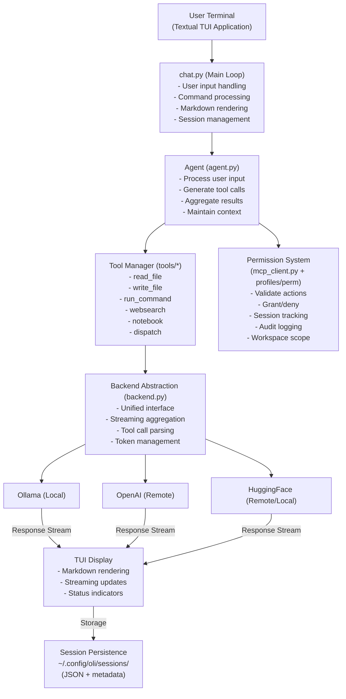

---

## Data Flow Diagram

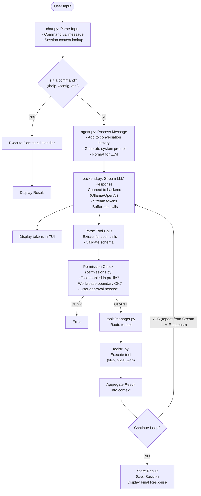

## Permission Flow Diagram

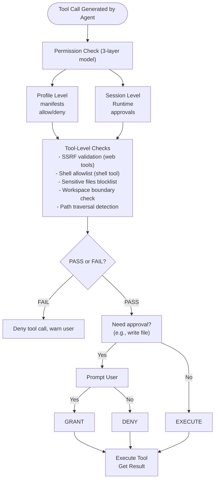

---

## Backend Selection Logic

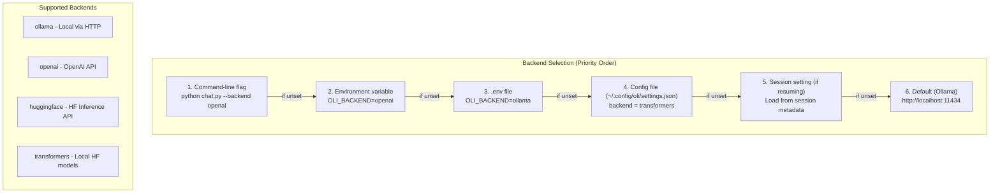

---

## Agent Pooling Architecture

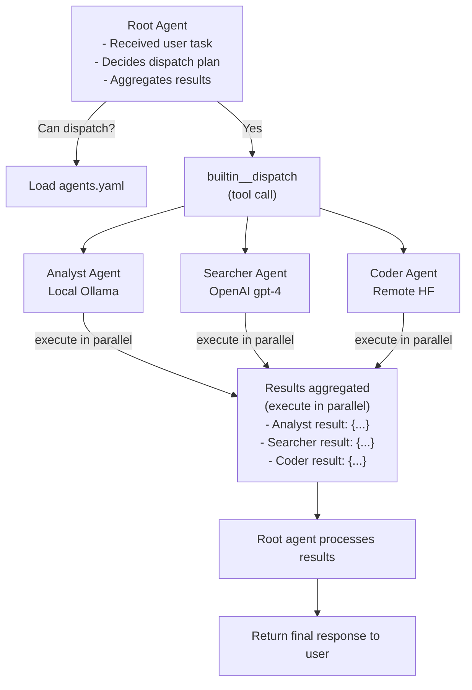

---

## Voice Mode Loop

`/voice` toggles a background `@work(exclusive=False)` worker (`_run_voice_loop`)
that runs alongside the normal `_generate_response` worker. All audio I/O is
blocking and offloaded via `asyncio.to_thread` so the Textual event loop never
stalls. Everything is local — no network calls.

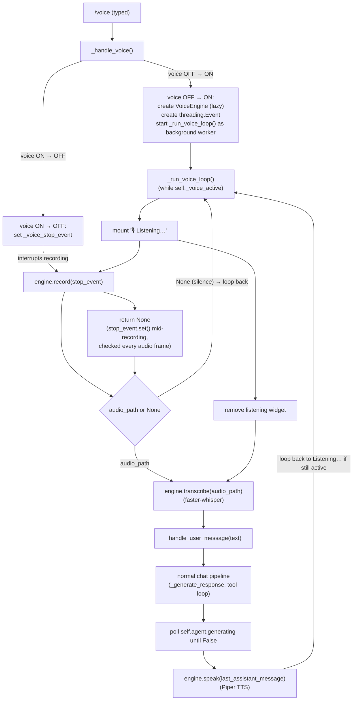

Key points:

- **Immediate interruption** — `VoiceEngine.record()` polls the shared
  `threading.Event` every audio frame, so toggling `/voice` off during an
  in-progress recording returns `None` right away instead of waiting out the
  silence/max-duration timeout (`SILENCE_TIMEOUT_MS` / `MAX_RECORD_SECONDS`).
- **Shares the normal pipeline** — transcribed text is fed through
  `_handle_user_message`, so tool calls, permission prompts, and session
  persistence all behave exactly as they do for typed input.
- **Lazy model loading** — `VoiceEngine.load()` (Whisper, Piper, WebRTC VAD)
  only runs on first activation, keeping TUI startup fast.
- **Also stopped on app exit** — `on_unmount` clears `_voice_active` and sets
  the stop event so a lingering recording doesn't block shutdown.

---

## State Machine: Chat Session

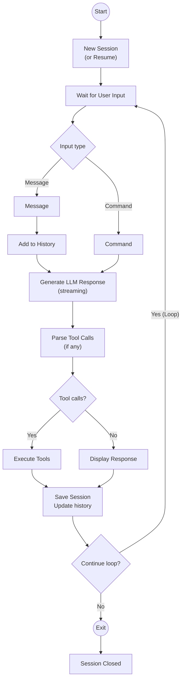

---

## Configuration Precedence (Lowest to Highest)

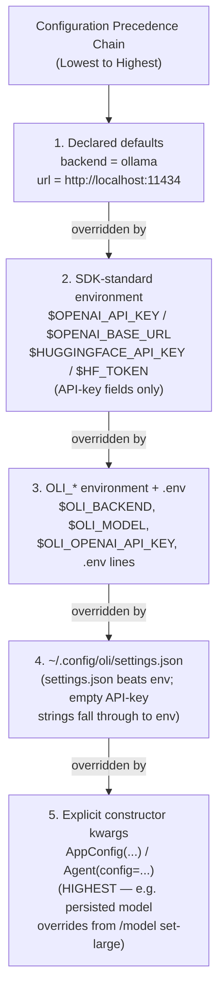

---

## Tool Execution Flow

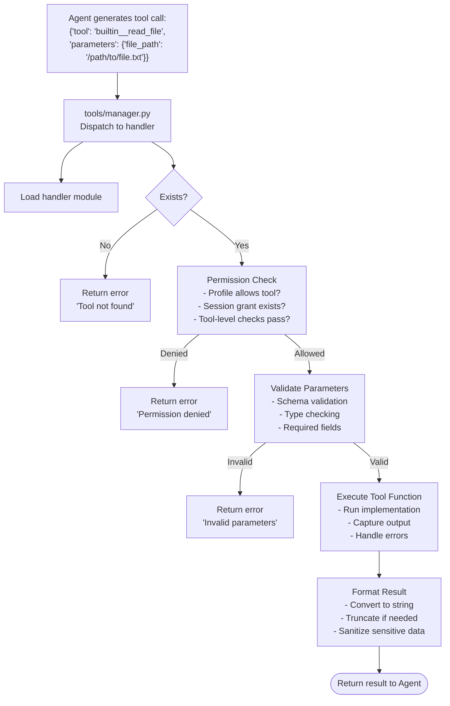

---

## Workspace Scoping

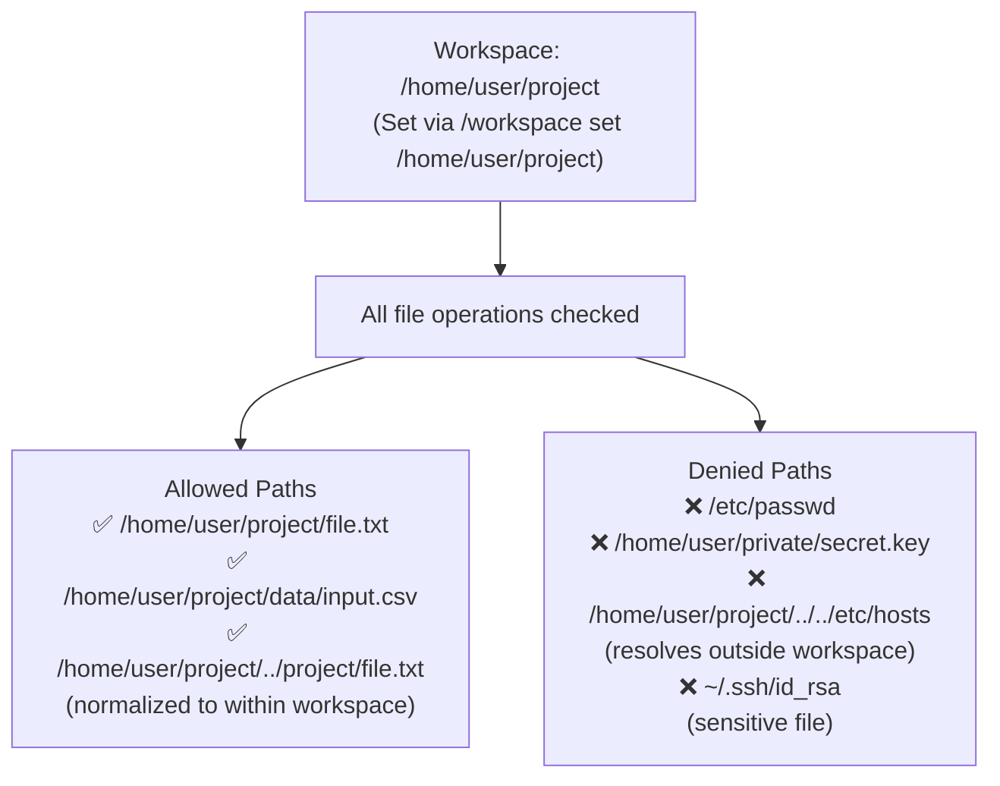

---

## Error Handling Flow

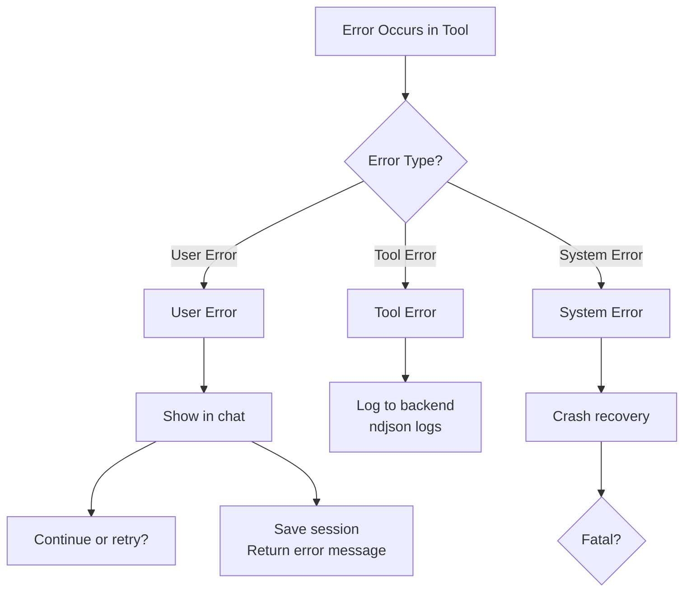

---

## Session File Structure

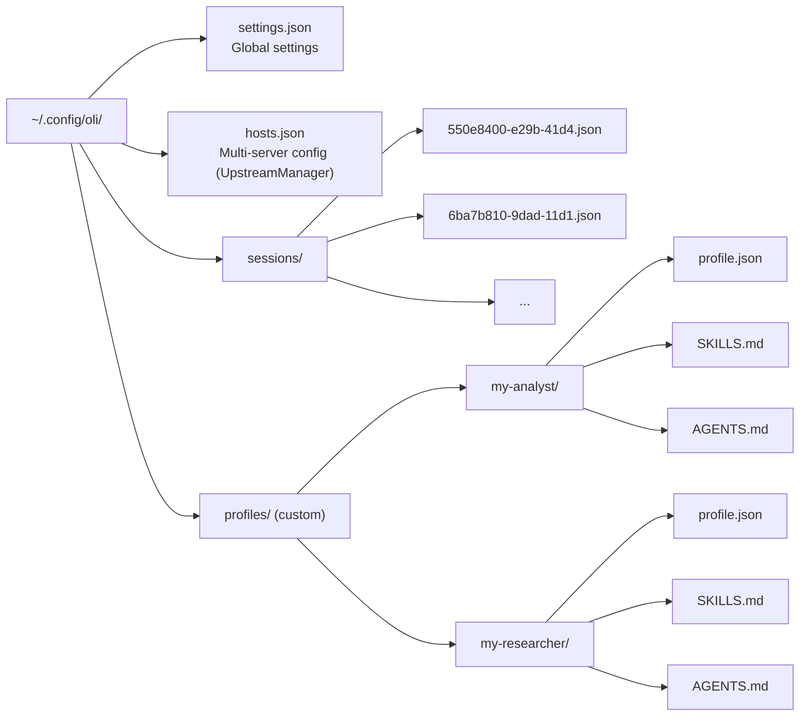

---

## Textual TUI Component Hierarchy

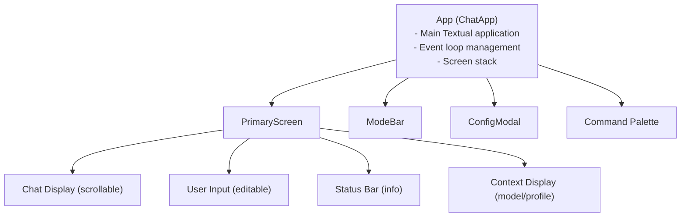

---

## Useful Architecture Patterns

| Pattern             | Usage                | Location         |
| ------------------- | -------------------- | ---------------- |
| **Factory**         | Backend creation     | backend.py       |
| **Strategy**        | Tool implementations | tools/\*.py      |
| **Observer**        | Textual events       | views.py         |
| **Builder**         | Config precedence    | settings.py      |
| **Adapter**         | Backend interface    | backends/        |
| **Registry**        | Tool management      | tools/manager.py |
| **Template Method** | Agent processing     | agent.py         |

---

## Deployment Architecture

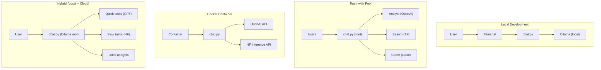

This comprehensive architecture reference provides a complete understanding of how oli-bot components interact, data flows through the system, and key decision points in execution paths.
