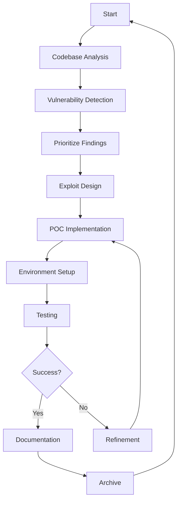

# Agentic Exploit Development & Execution Workflow

## Overview

This workflow outlines a systematic approach for autonomous agents to analyze codebases, identify vulnerabilities, and develop working proof-of-concept exploits.

## Phase 1: Codebase Analysis & Assessment

### 1.1 Initial Discovery

- **Tooling**: `find`, `ls`, `tree`, `fd`
- **Actions**:
  - List directory structure
  - Identify main entry points
  - Locate configuration files
  - Map project architecture
- **Key Questions**:
  - What language/framework is being used?
  - What are the main components?
  - What external dependencies exist?

### 1.2 Dependency Analysis

- **Tooling**: `grep`, `cat`, `cat package.json`, `cat requirements.txt`, `cat go.mod`, `cat Cargo.toml`
- **Actions**:
  - Read dependency manifests
  - Identify version numbers
  - Check for known vulnerable versions
- **Output**: Dependency inventory with versions

### 1.3 Configuration Review

- **Tooling**: `cat`, `grep`, `find`
- **Actions**:
  - Review configuration files
  - Identify exposed services
  - Check authentication mechanisms
  - Analyze logging configurations
- **Key Focus Areas**:
  - Database configurations
  - API endpoints
  - Authentication settings
  - Error handling

## Phase 2: Vulnerability Detection

### 2.1 Static Code Analysis

- **Tooling**: `grep`, `rg`, `ag` with regex patterns
- **Actions**:
  - Search for common vulnerability patterns
  - Identify hardcoded credentials
  - Find SQL injection vectors
  - Detect buffer overflows
  - Check for path traversal issues
- **Common Patterns to Search**:
  - `SELECT * FROM` → SQL injection
  - `eval(` → Code injection
  - `system(` → Command injection
  - `file_get_contents()` → File inclusion
  - `unserialize()` → Deserialization issues

### 2.2 Dependency Vulnerability Scan

- **Tooling**: `pip-audit`, `npm audit`, `cargo audit`, `go list -m -json all`
- **Actions**:
  - Scan for known vulnerabilities in dependencies
  - Check for outdated packages
  - Identify CVEs
- **Output**: Vulnerability report with severity levels

### 2.3 Code Review & Pattern Matching

- **Tooling**: `grep`, `rg`, `ag`, custom analysis scripts
- **Actions**:
  - Analyze user input handling
  - Review error handling
  - Check for unsafe operations
  - Identify race conditions
- **Focus Areas**:
  - Input validation
  - Output encoding
  - State management
  - Resource cleanup

## Phase 3: Exploit Development Strategy

### 3.1 Attack Vector Identification

- **Actions**:
  - Prioritize vulnerabilities by severity
  - Determine feasibility of exploitation
  - Assess required conditions
  - Identify potential mitigations
- **Decision Criteria**:
  - CVSS score
  - Exploit complexity
  - User interaction required
  - Impact scope

### 3.2 Proof-of-Concept Design

- **Actions**:
  - Define exploit requirements
  - Design minimal working example
  - Identify necessary dependencies
  - Plan testing strategy
- **Output**: Exploit specification

### 3.3 Proof-of-Concept Implementation

- **Actions**:
  - Write minimal exploit script
  - Implement necessary utilities
  - Add error handling
  - Include logging
- **Code Structure**:

  ```python
  # Example structure
  import requests
  import logging
  from typing import Optional

  logging.basicConfig(level=logging.INFO)
  logger = logging.getLogger(__name__)

  class Exploit:
      def __init__(self, target: str):
          self.target = target
          self.session = requests.Session()

      def exploit(self, payload: str) -> bool:
          # Implementation
          pass

      def cleanup(self):
          # Cleanup logic
          pass
  ```

## Phase 4: Testing & Validation

### 4.1 Environment Setup

- **Actions**:
  - Create isolated test environment
  - Set up necessary dependencies
  - Configure test infrastructure
  - Document requirements
- **Safety Measures**:
  - Use Docker containers
  - Network isolation
  - Resource limits

### 4.2 Exploit Execution

- **Tooling**: Custom exploit scripts, `curl`, `nc`, `telnet`
- **Actions**:
  - Execute proof-of-concept
  - Capture output
  - Monitor system state
  - Verify vulnerability
- **Success Criteria**:
  - Expected output achieved
  - No unexpected side effects
  - Vulnerability confirmed

### 4.3 Validation & Refinement

- **Actions**:
  - Test edge cases
  - Validate assumptions
  - Refine exploit code
  - Add robustness features
- **Output**: Validated exploit script

## Phase 5: Documentation & Reporting

### 5.1 Detailed Findings

- **Actions**:
  - Document vulnerability details
  - Include code examples
  - Explain impact
  - Provide reproduction steps
- **Report Structure**:
  - Executive Summary
  - Technical Details
  - Vulnerability Description
  - Proof-of-Concept
  - Expected Results

### 5.2 Usage Instructions

- **Actions**:
  - Create comprehensive README
  - Document dependencies
  - Provide examples
  - Include troubleshooting
- **Documentation Requirements**:
  - Installation instructions
  - Usage examples
  - Expected outputs
  - Error handling

### 5.3 Proof-of-Concept Archive

- **Actions**:
  - Organize scripts
  - Tag versions
  - Add metadata
  - Create manifest
- **File Organization**:
  ```
  exploits/
  ├── README.md
  ├── requirements.txt
  ├── exploit.py
  ├── test_exploit.sh
  ├── payloads/
  ├── utils/
  └── docs/
  ```

## Phase 6: Safety & Best Practices

### 6.1 Execution Safety

- **Practices**:
  - Always work in isolated environment
  - Use resource limits
  - Implement timeout mechanisms
  - Add cleanup procedures
  - Monitor resource usage

### 6.2 Logging & Monitoring

- **Requirements**:
  - Comprehensive logging
  - Output capture
  - State tracking
  - Error reporting

### 6.3 Cleanup Procedures

- **Actions**:
  - Remove temporary files
  - Reset environment
  - Document changes
  - Verify system state

## Tool Recommendations

### Code Analysis

- `grep`, `rg`, `ag` - Pattern searching
- `find`, `fd` - File discovery
- `cat`, `head`, `tail` - File reading

### Dependency Management

- `pip-audit`, `npm audit`, `cargo audit`, `go list -m -json all`

### Exploit Development

- Custom Python/Go/JavaScript scripts
- Standard libraries for networking
- Frameworks for exploit building

### Testing

- Docker for isolation
- Virtual environments
- Test frameworks

## Success Metrics

1. **Detection Rate**: Percentage of vulnerabilities identified
2. **False Positive Rate**: Rate of incorrect detections
3. **Exploit Success Rate**: Percentage of POCs that work
4. **Documentation Quality**: Completeness and clarity
5. **Safety**: Minimal impact on test environment

## Common Pitfalls to Avoid

1. **Overlooking dependencies**: Always check third-party libraries
2. **Ignoring configuration**: Often overlooked but critical
3. **Skipping validation**: Always verify findings
4. **Poor documentation**: Makes exploits hard to use
5. **Unsafe testing**: Can damage production systems

## Continuous Improvement

1. **Pattern Database**: Maintain database of common patterns
2. **Tool Integration**: Integrate with existing security tools
3. **Learning Loop**: Learn from each execution
4. **Performance Optimization**: Improve speed and efficiency
5. **Safety Enhancements**: Add more safety features

## Example Workflow



## Notes

- Adapt workflow to specific technology stack
- Customize based on project requirements
- Maintain flexibility for different vulnerability types
- Always prioritize safety and reproducibility
- Document everything thoroughly
